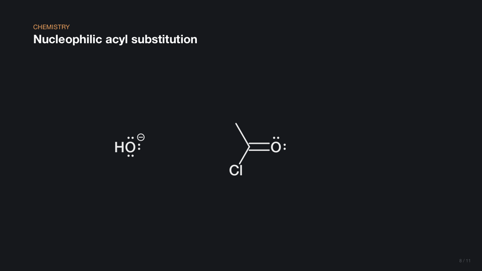
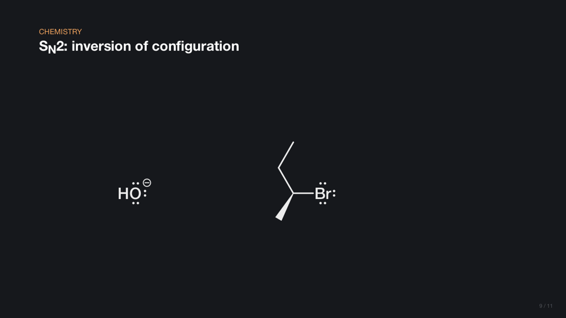
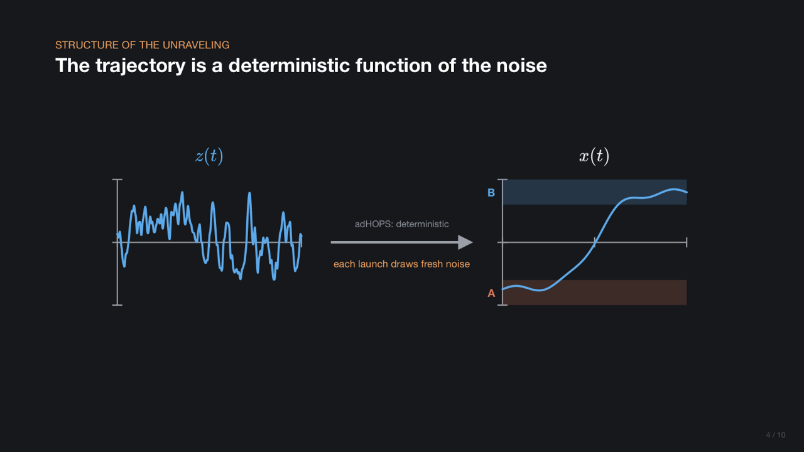
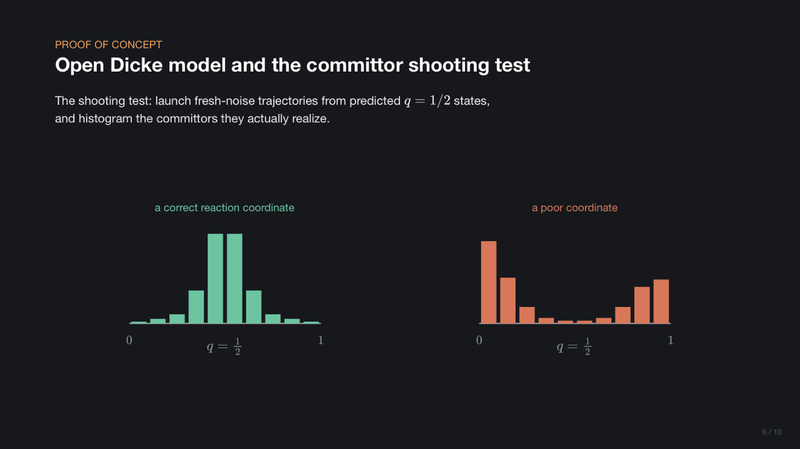
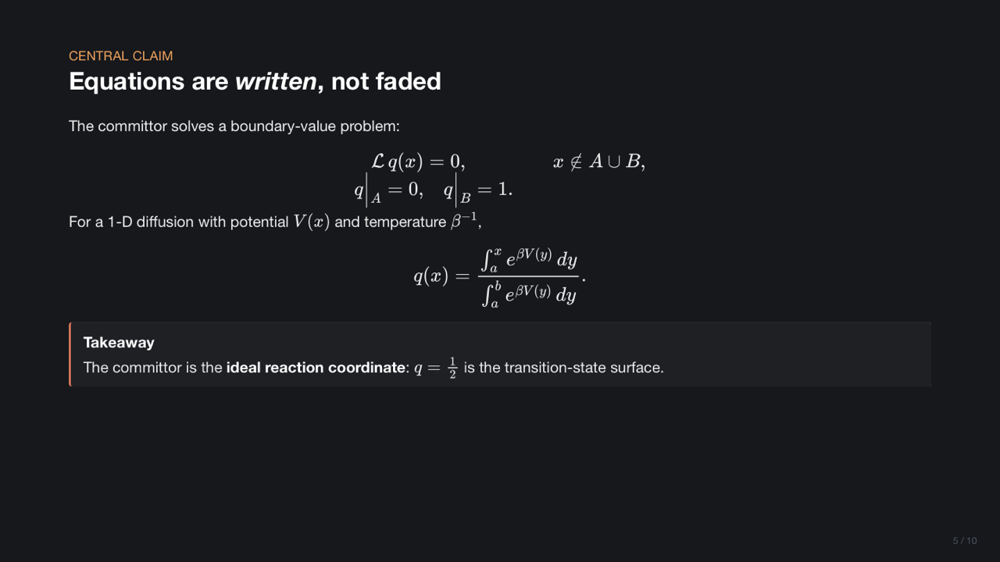
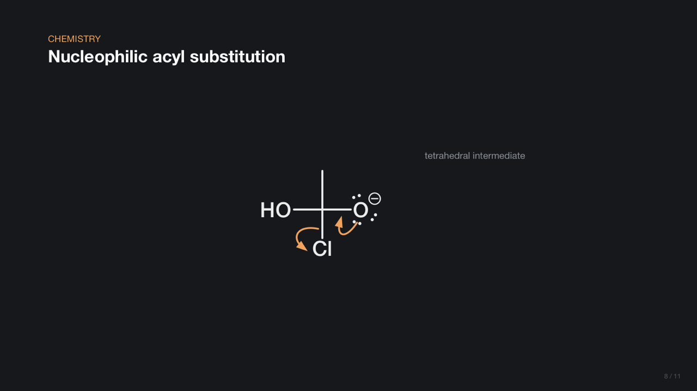
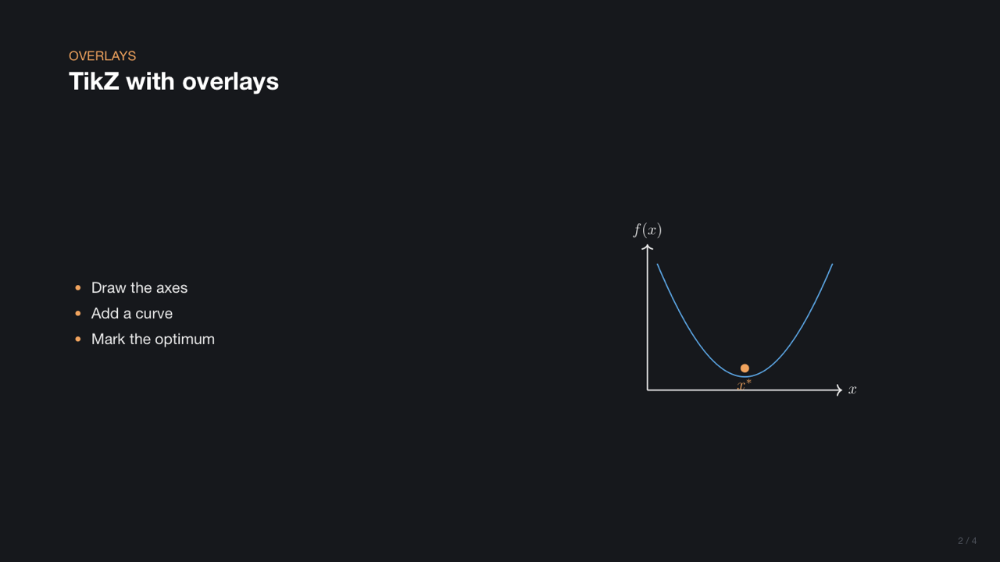
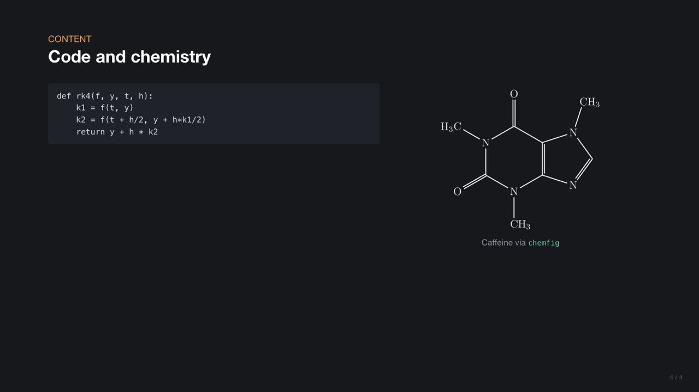

# Aurora

**Beamer in, manim-style animated slides out.**

Aurora compiles an ordinary Beamer `.tex` deck into a single self-contained HTML
file that animates like a [manim](https://www.manim.community/) video. Equations
are *written* stroke by stroke, curves draw themselves, numbers tick live, and
organic-chemistry mechanisms play out with curly arrows. You still click through
it like a normal deck.

<p align="center"></p>

```latex
\begin{frame}{Nucleophilic acyl substitution}
\begin{scene}
  \Molecule[id=nu, at={-4.6,0.2}, lp=auto]{[OH-:5]}
  \Molecule[id=r, at={-0.6,0}, lp={3}, with]{[CH3:1][C:2](=[O:3])[Cl:4]}
  \pause
  \CurlyArrow[from=lp:5, to=2]
  \CurlyArrow[from=2=3, to=3, with]
  \pause
  \Transform[id={r,nu}]{[CH3:1][C:2]([O-:3])([Cl:4])[OH:5]}
\end{scene}
\end{frame}
```

<p align="center">
  
  
</p>

**Try it:** open [`docs/demo.html`](docs/demo.html) in a browser (or the GitHub Pages
copy once Pages is enabled for `/docs`) and press → to step through.

## Why

- **Keep writing Beamer.** Existing decks compile as they are: `\pause`, overlays,
  `itemize`, `columns`, blocks, theorems, tables, listings, and TikZ (rendered by
  your real LaTeX, overlays included). Add a `\usepackage{aurora}` line and the same
  file still builds a PDF with `pdflatex`.
- **Manim's look, minus the render loop.** The motion vocabulary is manim's: Write,
  Create, GrowFromCenter, ValueTracker, TransformMatchingTex, all on its easing
  curve. Everything runs live in the browser, so there are no videos to re-render.
- **Chemistry built in.** Molecules come from SMILES and are laid out by RDKit.
  Electron-pushing arrows are addressed by atom-map number. `\Transform` morphs one
  mechanism step into the next: atoms glide, new bonds form, leaving groups drift off.
- **One file to share.** The output is a single offline HTML file with no server
  or CDN. It includes a speaker view with notes and a timer, an overview grid, and
  deep links to any step.
- **Built for AI agents too.** It has a machine-readable command reference, JSON
  diagnostics with line numbers, PNG snapshots with overflow detection, and an
  agent skill. See [For AI agents](#for-ai-agents).

## Quick start

```sh
npm install -g aurora-slides        # or use `npx aurora-slides …`
aurora init my-talk                 # deck.tex + aurora.sty + AGENTS.md
aurora serve my-talk/deck.tex       # live preview at http://127.0.0.1:3000
aurora build my-talk/deck.tex       # → my-talk/deck.html
```

This needs Node ≥ 22.18. LaTeX is **optional**: you only need it for TikZ and
chemfig fragments (`latex` + `dvisvgm`, both part of TeX Live / MacTeX) and for
building the PDF version.

In the browser:

| Key | |
|---|---|
| → / space / click | Next step. If an animation is still running, the first press finishes it. |
| ← | Previous step (snaps to that step's final state) |
| `o` | Overview grid |
| `s` | Speaker view in a second window (notes, next step, timer), kept in sync |
| `f` | Fullscreen |
| `?` | Help |

## Writing slides

### Plain Beamer

| You write | You get |
|---|---|
| `\section{Results}` | Orange section label above each following title |
| `\begin{frame}{Title}{Subtitle}` | Title header |
| `\pause`, `\item<2->`, `\begin{itemize}[<+->]`, `\only<2>{…}`, `\uncover<3->{…}`, `\alert<2>{…}` | Click steps, each animated in |
| `$…$`, `\[…\]`, `align*`, `equation*` | MathJax SVG. Display maths is *written* glyph by glyph. |
| `columns`, `block`, `alertblock`, `exampleblock`, `theorem`, `definition`, `proof` | Themed layout |
| `tabular` (with `booktabs`, `\multicolumn`, `\pause` between rows) | Native HTML tables |
| `lstlisting`, `verbatim`, `minted` | Code blocks |
| `\includegraphics` | Embedded image (PNG/JPG/SVG) |
| `tikzpicture`, `\chemfig`, `circuitikz`, `tikzcd`, `\begin{latex}…\end{latex}` | Compiled with your LaTeX to theme-coloured SVG. Overlays such as `\draw<2->` and `\only<3>` become steps. |
| `\note{…}` | Speaker notes |
| `\newcommand`, `\definecolor`, `\DeclareMathOperator` | Work in both text and maths |
| `\auroratheme{light}` (preamble) | Light palette for bright rooms. The default is the dark manim look. |

### Scenes: animated diagrams

Put a `scene` in any frame. Its commands are named after manim classes:

```latex
\begin{scene}[size={16,6}]                          % units; 1 unit = 100 px
  \Axes[id=ax, w=9, h=4, x={0,10,1}, y={-1.2,1.2,0.6}]
  \ValueTracker[id=k, value=1]
  \MathTex[at={5.6,1.7}, color=blue]{\sin(kx)}
  \pause
  \Plot[on=ax, color=blue]{sin(k*x)}               % draws on (Create)
  \pause
  \Animate[k=3, run=2]                              % the curve re-plots live
\end{scene}
```

Objects: `Axes Plot Line Arrow Dot Circle Rect Band Bars MathTex Text
DecimalNumber ValueTracker Molecule CurlyArrow ReactionArrow`.
Actions: `Animate Transform TransformTex FadeOut Indicate Wait`.
Every key is listed in **[docs/REFERENCE.md](docs/REFERENCE.md)** (`aurora reference` prints it too).

- `\pause` inside a scene is a click step, shared with the rest of the frame.
- Within a step, events run in sequence. Add `with` to run one alongside the
  previous event, and `delay=` to stagger.
- Numeric keys accept expressions over trackers (`at={10*t-5, 0}`) using helpers
  such as `sigmoid`, `gauss`, `smoothstep`, and `noise(x, seed)` for stochastic-looking curves.

### Chemistry

<p align="center"></p>

- `\Molecule[lp=auto]{SMILES}`: skeletal formula with lone pairs. Atom maps
  (`[C:2]`) name atoms.
- `\CurlyArrow[from=lp:5, to=2]`: refs are `N` (atom), `N-M`/`N=M` (bond, or a
  forming bond's midpoint), and `lp:N` (lone pair). Add `fishhook` for radical chemistry.
- `\Transform[id={a,b}]{product SMILES}`: mapped atoms move; other atoms and
  bonds fade in or out; separate fragments with `.`.
- `\ReactionArrow[above={\ce{H2O}}, below={\Delta}]`, and `\ce{…}` (mhchem) in any maths.

## Gallery

| | |
|---|---|
|  |  |
|  |  |
|  |  |

## Command line

```
aurora build <deck.tex> [-o out.html] [--json]
aurora serve <deck.tex> [--port 3000]
aurora check <deck.tex> [--json] [--strict]
aurora snapshot <deck.tex> [--out dir] [--slides 1,3-5] [--all-steps] [--json]
aurora init [dir] [--template basic|chemistry]
aurora reference [--json | --md]
```

`snapshot` uses Playwright, an optional dependency:
`npm i -D playwright && npx playwright install chromium`.

## For AI agents

Aurora is designed so that a coding agent can write a deck end to end and check its own work:

- **`AGENTS.md`** is created by `aurora init` in every new deck folder. It is a
  compact authoring guide covering the edit, check, and look loop, layout budget,
  recipes, and gotchas.
- **[`skills/aurora-slides/SKILL.md`](skills/aurora-slides/SKILL.md)** is an Agent
  Skill. Copy it into `~/.claude/skills/` (or your agent's skills folder).
- **`aurora reference --json`** emits the full command schema: every object, key,
  type, and default.
- **`aurora check --json`** emits structured warnings with line numbers and
  "did you mean" suggestions for misspelled keys and commands.
- **`aurora snapshot --json`** renders a PNG per slide and reports any slide whose
  content overflows, plus runtime errors.
- **[`llms.txt`](llms.txt)** is a one-page index for LLMs.
- In the browser, `window.aurora` exposes `next()`, `prev()`, `jump(slide, step)`,
  `steps(slide)` and `busy()` for automation.

## Examples

- [`examples/demo.tex`](examples/demo.tex): the showcase (plots, trackers,
  histograms, mechanisms, equation morphs).
- [`examples/classic.tex`](examples/classic.tex): an unmodified-style Beamer deck
  with TikZ overlays, booktabs, a listing, and chemfig.
- `templates/`: what `aurora init` starts you with.

## How it works

The compiler (TypeScript, `src/`) reads the TeX, turns overlays into a compact
step timeline, renders maths with MathJax and molecules with RDKit at build time,
and writes one HTML file. That file contains the slides, a JSON description of
each scene, and a small dependency-free runtime (`runtime/aurora.js`): an
animation engine with manim's rate functions, plus a scene renderer and the
player. More detail is in [docs/DESIGN.md](docs/DESIGN.md).

## Contributing

See [CONTRIBUTING.md](CONTRIBUTING.md). `npm run check` typechecks, runs the
tests, and validates the demo deck.

## License

[MIT](LICENSE)
